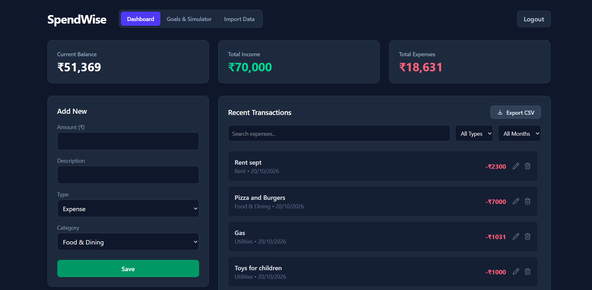
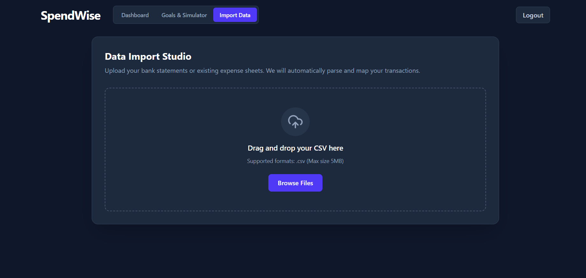
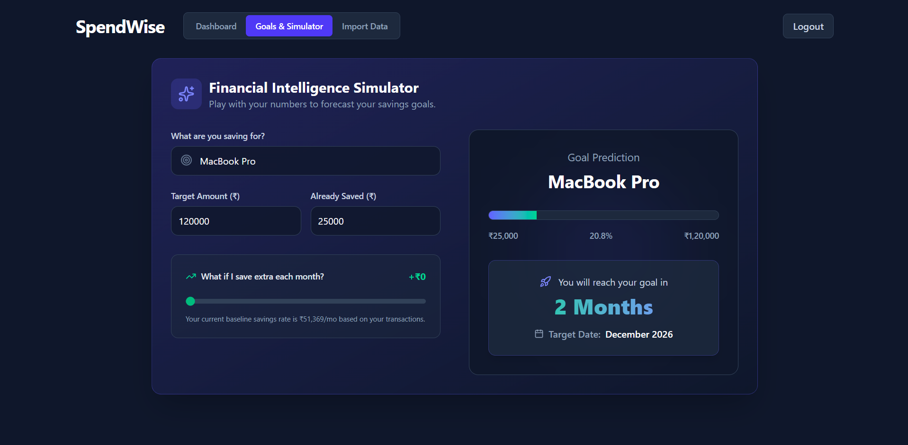
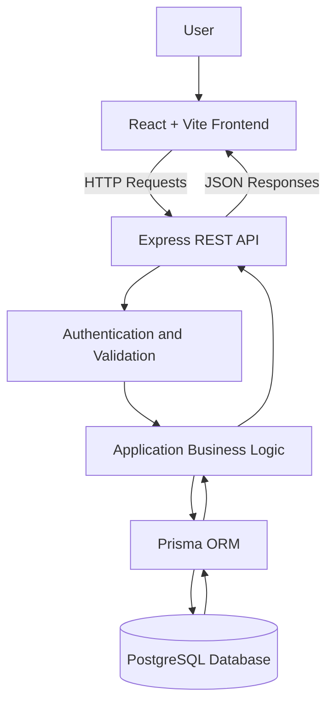

# 💸 SpendWise — Smart Personal Finance Tracker

<p align="center">
  <strong>Spend Smarter. Save Better.</strong>
  <br />
  Track expenses, understand spending patterns, and plan your financial future with an intuitive full-stack finance application.
  <br /><br />

  
  
  
  
  
</p>

---

## 📌 Overview

**SpendWise** is a full-stack personal finance management application built to help users understand where their money goes and make more informed financial decisions.

It combines transaction tracking, interactive financial dashboards, CSV data imports, spending analysis, and savings projections in one platform.

Designed with a modern React frontend and a Node.js backend, SpendWise demonstrates practical full-stack engineering, RESTful API development, relational database design, authentication, and data visualization.

## ✨ Features

### 📊 Interactive Financial Dashboard
- View income, expenses, and savings at a glance.
- Visualize financial activity through interactive charts.
- Analyze category-wise spending distribution.
- Monitor monthly financial trends.

### 💳 Transaction Management
- Create, edit, and delete income and expense transactions.
- Organize transactions by category and date.
- Maintain a centralized transaction history.
- Search and filter financial records.

### 📁 CSV Import Studio
- Import existing financial transactions from CSV files.
- Parse CSV data using **PapaParse**.
- Validate imported records before processing.
- Support bulk insertion for efficient data handling.

### 🎯 Savings Simulator
- Set personal savings targets.
- Project future savings using configurable assumptions.
- Understand how monthly contributions affect financial goals.
- Explore different savings scenarios.

### 💡 Spending Insights & Budgeting
- Understand spending patterns across categories.
- Compare financial activity over different periods.
- Identify potential overspending.
- Use financial summaries to make better budgeting decisions.

### 🔐 Authentication & Data Privacy
- User registration and login.
- JWT-based authentication.
- Password hashing with bcrypt.
- Protected routes and user-specific data access.

### 📱 Responsive User Experience
- Clean interface built with React and Tailwind CSS.
- Responsive layouts for desktop, tablet, and mobile.
- Component-based frontend architecture.
- Intuitive navigation and interactive visualizations.

## 🖥️ Application Preview

Add screenshots of your actual application to the `screenshots/` directory.

<p align="center">
  
  <br />
  <em>Financial dashboard — income, expenses, savings, and spending trends.</em>
</p>

<p align="center">
  
  <br />
  <em>CSV Import Studio — importing and validating financial transactions.</em>
</p>

<p align="center">
  
  <br />
  <em>Savings Simulator — exploring future savings scenarios.</em>
</p>

> **Note:** These are image paths, not embedded screenshots. Add the corresponding PNG files to your repository or replace the paths with your actual screenshot filenames.

## 🛠️ Tech Stack

| Layer | Technologies |
|---|---|
| Frontend | React.js, Vite, JavaScript |
| Styling | Tailwind CSS |
| Routing | React Router DOM |
| Data Visualization | Interactive charts |
| CSV Processing | PapaParse |
| Backend | Node.js, Express.js |
| API | RESTful APIs |
| Database | PostgreSQL |
| ORM | Prisma |
| Authentication | JWT, bcrypt |
| Frontend Deployment | Vercel |
| Backend Deployment | Render |
| Database Hosting | Supabase / Neon |

## 🏗️ Architecture

SpendWise follows a client-server architecture that separates the user interface, application logic, and persistent data storage.



### Application Flow

1. Users interact with the React frontend.
2. The frontend sends requests to the Express API.
3. The backend authenticates users and validates incoming data.
4. Prisma manages database queries and mutations.
5. PostgreSQL stores financial records.
6. The API returns data for dashboard summaries, charts, and reports.

## 🚀 Getting Started

Follow these steps to run SpendWise locally.

### Prerequisites

- [Node.js](https://nodejs.org/) — preferably an active LTS release.
- npm.
- [Git](https://git-scm.com/).
- A PostgreSQL database, local or hosted.

### 1. Clone the Repository

```bash
git clone https://github.com/manas6265517/spendwise.git
cd spendwise
```

### 2. Configure the Backend

```bash
cd backend
npm install
```

Create a `.env` file in the `backend/` directory:

```env
DATABASE_URL="your_postgresql_connection_string"
JWT_SECRET="your_long_random_secret"
PORT=5000
```

Generate the Prisma Client and synchronize the database schema:

```bash
npx prisma generate
npx prisma db push
```

Start the backend:

```bash
npm run dev
```

The API should run at `http://localhost:5000`, provided the port and development script match your configuration.

### 3. Configure the Frontend

Open a second terminal from the repository root:

```bash
cd frontend
npm install
```

Create a `.env` file in the `frontend/` directory:

```env
VITE_API_URL="http://localhost:5000"
```

Start the frontend:

```bash
npm run dev
```

Open the local URL displayed by Vite, typically `http://localhost:5173`.

### 4. Verify the Setup

- Register or sign in to your account.
- Add sample income and expense transactions.
- Check the dashboard summaries and charts.
- Test CSV import functionality.
- Explore the savings simulator.

> **Setup note:** These instructions assume your repository contains separate `frontend/` and `backend/` directories and the required npm scripts. Adjust the commands if your actual project structure differs.

## 🌐 Deployment

The application can be deployed using the following architecture:

| Component | Platform |
|---|---|
| Frontend | Vercel |
| Backend API | Render |
| PostgreSQL Database | Supabase or Neon |

### Production Checklist

- Configure production environment variables.
- Set `VITE_API_URL` to the deployed backend URL.
- Configure CORS for the frontend's production origin.
- Ensure the database schema is applied.
- Keep credentials and secrets out of version control.
- Verify authentication, API requests, and database operations after deployment.

## 🗺️ Roadmap

Potential improvements for future releases:

- [ ] Advanced spending analytics and month-over-month comparisons.
- [ ] Category-wise monthly budgets and overspending alerts.
- [ ] Recurring transactions and subscription tracking.
- [ ] Downloadable PDF financial reports.
- [ ] Optional email summaries and budget reminders.
- [ ] Smarter transaction categorization.
- [ ] Multiple savings goals with progress tracking.
- [ ] Automated unit and API integration tests.
- [ ] Progressive Web App support for an installable experience.

## 🔒 Security Practices

- Hash passwords instead of storing them in plain text.
- Validate incoming data on the server.
- Enforce authentication and authorization on protected endpoints.
- Restrict access to each user's financial records.
- Store secrets in environment variables.
- Use HTTPS and appropriately configured CORS in production.

## 🤝 Contributing

Suggestions, bug reports, and improvements are welcome.

1. Fork this repository.
2. Create a feature branch.
3. Implement and test your changes.
4. Open a pull request with a clear description.

## 👨‍💻 Author

**Manas Ranjan Haiburu**

- GitHub: [@manas6265517](https://github.com/manas6265517)
- LinkedIn: [Manas Ranjan Haiburu](https://www.linkedin.com/in/manas-ranjan-haiburu-4378332b7/)

---

<p align="center">
  <strong>SpendWise — Spend Smarter. Save Better. 💚</strong>
  <br />
  <sub>Built to make personal finance easier to understand.</sub>
</p>
